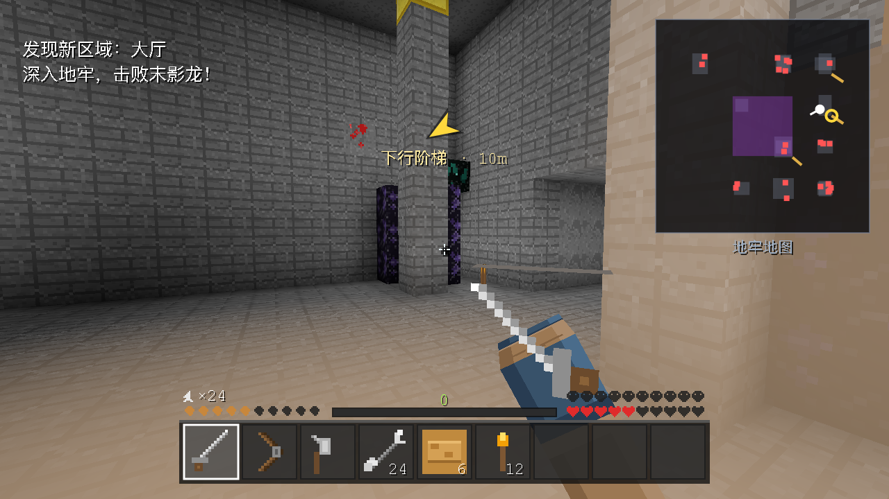
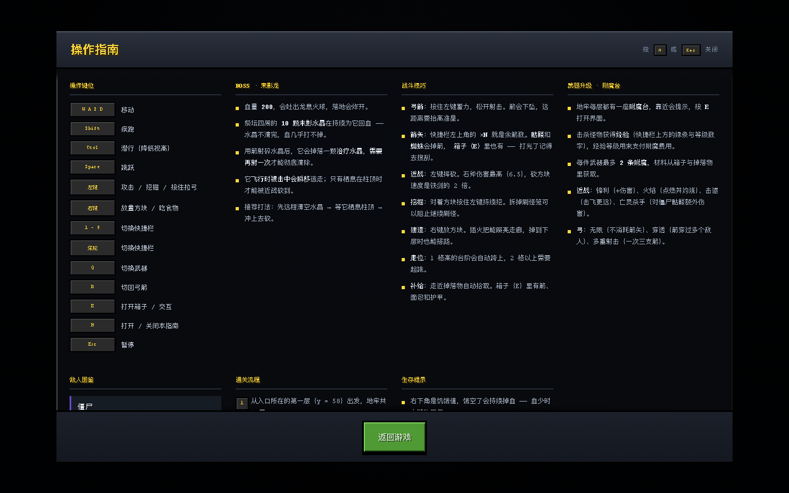
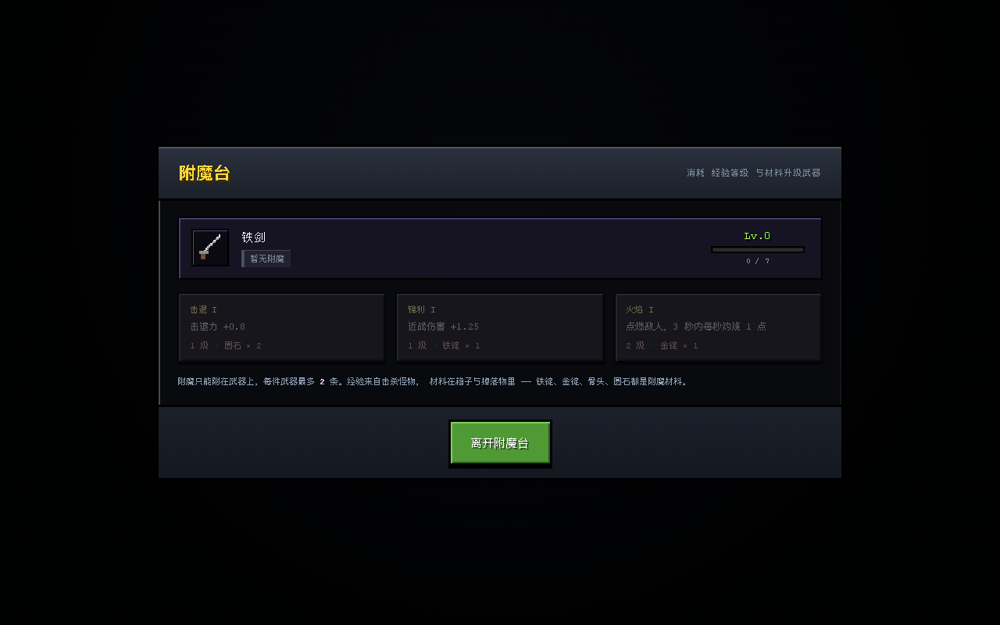

# MINECRAFT: 地下城突袭

一款以《我的世界》为题材的**第一人称地牢射击游戏**（CS-like）。玩家手持剑、斧、弓，深入四层地下城，
最终在祭坛上击败 **末影龙**。

全部内容**程序化生成** —— 没有一张外部贴图、一个模型文件或音频文件：
体素纹理由 Canvas 逐像素绘制，方块网格在运行时构建，地牢结构由算法生成，音效由 WebAudio 合成。



---

## 快速开始

```bash
npm install
npm run dev        # 打开 http://localhost:5173
```

地牢是程序化生成的，可以用 `?seed=xxxx` 换一个种子重开一局（例如 `http://localhost:5173/?seed=42`）。

生产构建：

```bash
npm run build && npm run preview
```

> 需要支持 WebGL2 的现代浏览器。点击「开始游戏」后浏览器会请求鼠标指针锁定（这是 FPS 的标准行为）。

---

## 可选主角

主菜单里挑一位主角，形象取自同目录下的 MineCrasher（2.5D 像素清关游戏）里的同名角色。

| 主角 | 形象 | 起始补给 |
|------|------|----------|
| **史蒂夫** | 经典方块人：深棕发、小胡子、青蓝衬衫配棕腰带 | 标准装备 |
| **杰杰** | 红色卫衣少年：厚刘海、蓝色大眼、白袖口与亮品红鞋 | 额外 铁锭 ×3、火把 ×4 |
| **麦琪** | 绿色小乌龟：龟壳横条纹、黑眼红嘴 | 额外 面包 ×2、治疗药水 ×1 |

主角影响两处：**第一人称手臂**的配色（袖子与皮肤颜色）和**起始补给**。
选择会存进 `localStorage`，下次打开还是它。

---

## 难度

主菜单可以直接选择难度，选择会被记住（存进 `localStorage`），下次打开还是这个难度。

| 难度 | 身边怪物上限（30 米内） | 单个刷怪笼上限（12 米内） | 刷怪间隔 | 刷怪半径 | 怪物伤害 | 初始怪物总预算 | 单房间初始上限 |
|------|--------------------------|---------------------------|----------|----------|----------|----------------|--------------------|
| **简单** | 4 | 2 | 30–42 秒 | 12 米 | ×0.6 | 5 只 | 刷怪间 / 墓穴 1 只，其余房间 1 只 |
| **普通** | 7 | 3 | 18–26 秒 | 16 米 | ×1.0 | 11 只 | 刷怪间 / 墓穴 2 只，其余房间 1 只 |
| **困难** | 11 | 4 | 11–17 秒 | 22 米 | ×1.4 | 19 只 | 刷怪间 / 墓穴 3 只，其余房间 1 只 |

- **身边怪物上限**：统计玩家 30 米内（垂直容差 12 米）的怪物总数，达到上限时刷怪笼会暂缓补怪，所以怪物**不会无限堆积**。
- **单个刷怪笼上限**：统计该笼子周围 12 米内的怪物数，防止全挤在一只笼子旁边。
- **刷怪间隔**：两次刷怪之间的基础间隔，另外还会叠加一段随机浮动（简单 0–12 秒 / 普通 0–8 秒 / 困难 0–6 秒）。
- **刷怪半径**：玩家进入这个距离后，刷怪笼才开始工作。
- **初始怪物总预算**：整座地牢预置怪物的目标总数，开局时**逐轮分配**（每轮先给每个房间最多补一只），所以每个房间都能分到怪，刷怪间与墓穴拿得多一些。
- 刷怪笼产物在离玩家 **70 米**外会被自动回收；**房间初始预置的怪不会被回收**。

---

## 地图与指引

右上角的小地图**只显示你当前这一层**，并且自带导航：

| 元素 | 含义 |
|------|------|
| **白点 + 白线** | 你，以及你面朝的方向 |
| **黄色脉冲圆环 + 虚线 + 距离** | 当前目标（虚线连着你和目标） |
| **金色菱形** | 下行竖井（通往下一层） |
| **金色方块** | 箱子 |
| **紫色方块** | 附魔台 |
| **红点** | 怪物 |
| **N 指针** | 指北针（地图上方是北） |

- 面板下方写着 **`1F / 4 层`** 和**当前所在房间名**（大厅 / 宝库 / 刷怪间 / 熔岩窟 / 藏书室 / 矿坑 / 墓穴）。
- 屏幕顶部有一条**目标条**：「第 1 层 / 4 层 · 目标：下行阶梯 · 24 米」；目标不在同一层时会写明**（在下面）**或**（在上面）**。
- 目标**不在画面里**时，屏幕边缘会出现一个**箭头**指向它。
- 屏幕正上方的**罗盘箭头**表示目标的**相对方向**（在左还是在右）。

目标随进度自动切换：找下行阶梯 → 找到末影龙祭坛 → 射末影水晶 → 打末影龙。

---

## 操作

游戏内随时按 **`H`** 打开《操作指南》（主菜单和暂停界面也有入口），
里面包含完整键位表、**物品图鉴**、战斗技巧、敌人图鉴、怪物刷新机制、末影龙机制与通关流程。



| 按键 | 作用 |
|------|------|
| `W A S D` | 移动 |
| `Shift` | 疾跑 |
| `Ctrl` | 潜行（降低视高） |
| `Space` | 跳跃 |
| 鼠标左键 | 攻击 / 挖掘方块 / 按住拉弓 |
| 鼠标右键 | 放置方块 / 吃食物 |
| `1`–`9` / 滚轮 | 切换快捷栏 |
| `Q` | 切换武器 |
| `R` | 切回弓箭 |
| `E` | 打开箱子 |
| `F` | 打开 / 关闭装备面板 |
| `H` | 打开 / 关闭操作指南 |
| `Esc` | 暂停 |

### 物品说明

图标光看形状认不出是什么，所以**快捷栏左侧常驻显示手上物品的名称、用途和附魔**，切换快捷栏即可查看。
完整清单（47 件物品，含图标与说明）在操作指南的「物品图鉴」里。

---

## 玩法

### 武器

| 武器 | 伤害 | 特点 |
|------|------|------|
| **铁剑** | 5 | 近战挥砍，CD 0.42s，附带击退 |
| **石斧** | 6.5 | 伤害更高、CD 0.62s，挖掘方块速度是铁剑的 2 倍 |
| **弓** | 最高 10 | 按住左键蓄力，箭有重力下坠，伤害与初速随蓄力提升 |

### 敌人

- **僵尸** — 血量 20，近战 3 伤害，成群逼近
- **骷髅** — 血量 16，保持距离并用箭远程射击
- **苦力怕** — 血量 16，靠近后引信自爆，范围 4 格高伤
- **蜘蛛** — 血量 12，速度极快，被攻击前保持中立

房间里还有**刷怪笼**，会持续在附近生成小怪 —— 但**有上限，不会无限堆积**：

- 玩家**身边 30 米内**（垂直容差 12 米，即只算同一层）的怪物总数不超过难度上限，到了上限刷怪笼就暂缓补怪。
- **单个刷怪笼 12 米内**也有自己的上限，不会全挤在一只笼子旁边。
- 刷怪间隔由难度决定（简单 30 秒、普通 18 秒、困难 11 秒起），另加一段随机浮动，避免整片房间同时开刷。
- 玩家不在刷怪半径内时刷怪笼不会工作。
- 新怪不会和别的怪叠在同一个格子里，也不会直接刷在你脸上。
- 刷怪笼产物在离玩家 **70 米**外会被自动回收，所以来回跑几趟也不会越堆越多；**房间初始预置的怪不会被回收**。
- 对着刷怪笼按住左键挖掉它，就能彻底断掉这个来源。

### 防具

防具分 **头盔 / 胸甲 / 护腿** 三个部位。按 `F` 打开装备面板查看、更换和升级。

| 部位 | 皮 | 铁 | 钻石 |
|------|----|----|------|
| **头盔** | 皮头盔（1） | 铁头盔（2） | 钻石头盔（4） |
| **胸甲** | 皮甲（3） | 铁甲（6） | 钻石甲（9） |
| **护腿** | 皮护腿（2） | 铁护腿（4） | 钻石护腿（6） |

括号里是**防御点数**。每点防御减伤 **4%**，最多减到 **70%**。
钻石全套 19 点防御 = 70% 减伤。

- **自动穿戴**：走到防具上直接穿上；身上已有更好的那件会留在背包里，在装备面板点「装备」换上。
- **来源**：**箱子（E）** 里约 25% 有防具；怪物也有 10% 概率掉落，**越深的层掉得越好**。
- **HUD**：快捷栏上方显示三个槽位和总防御点数。

### 经验与附魔（武器与防具升级）

击杀怪物获得**经验**（HUD 快捷栏上方的绿条与等级数字）。地牢**每层都有一座附魔台**，
靠近会提示，按 `E` 打开界面，给手上的剑、斧或弓附魔；防具则在**装备面板**里点「附魔」
（同样要站在附魔台旁边）。每件装备最多 **2 条**附魔，
消耗经验等级 + 材料（铁锭 / 金锭 / 骨头 / 圆石）。

| 附魔 | 适用 | 效果 |
|------|------|------|
| **锋利** | 近战 | 伤害 +1.25 / 级 |
| **火焰** | 近战 | 点燃敌人，持续灼烧 |
| **击退** | 近战 | 击飞更远 |
| **亡灵杀手** | 近战 | 对僵尸与骷髅额外伤害 |
| **无限** | 弓 | 射箭不消耗箭矢 |
| **穿透** | 弓 | 箭可额外穿过敌人 |
| **多重射击** | 弓 | 一次射出 3 支箭 |
| **保护** | 防具 | 受到的所有伤害降低 8% / 级 |
| **坚韧** | 防具 | 护甲防御 +1 / 级 |
| **荆棘** | 防具 | 反弹 2 点伤害给攻击者 / 级 |
| **生命** | 防具 | 最大生命 +2 / 级 |



### 箭矢从哪来

HUD 快捷栏左上角的 `×N` 就是剩余箭数。**骷髅**（55%）和**蜘蛛**（30%）会掉落箭矢，
**箱子（E）** 里的战利品也包含 6–14 支箭。开局自带 24 支。

### BOSS：末影龙

完全还原《我的世界》末地战机制：

1. 祭坛四周有 **10 颗末影水晶**，每颗都在为末影龙持续回血
2. 用**箭**射碎水晶 → 水晶掉落成「治疗水晶」，**再射一次**才能彻底清除
3. 水晶全清后，末影龙不再回血
4. 末影龙在飞行时被击中会**瞬移**（MC 原版机制），只有**栖息**在柱顶时才能被近战砍到

末影龙血量 200，会吐出龙息火球。

---

## 技术实现

```
src/
├── main.js                 游戏主循环、战斗与交互逻辑
├── core/
│   ├── input.js            键鼠输入 + 指针锁定
│   ├── audio.js            WebAudio 程序化音效
│   ├── difficulty.js        难度预设（刷怪上限 / 间隔 / 伤害倍率）
│   ├── characters.js       可选主角（史蒂夫 / 杰杰 / 麦琪）
│   ├── floors.js           楼层高度与层号判定
│   └── utils.js            数学工具、随机数、体素射线步进
├── world/
│   ├── blocks.js           方块注册表（材质/硬度/光照/碰撞）
│   ├── atlas.js            16×16 像素纹理图集（Canvas 逐像素绘制）
│   ├── materials.js        世界着色器（烘焙光照 + 手持火把 + 距离雾）
│   ├── mesher.js           体素网格化（AO 环境光遮蔽 + 平滑光照）
│   ├── physics.js          AABB 碰撞解算与自动上台阶
│   ├── world.js            体素存储 + 天光/块光 BFS 传播
│   └── dungeon.js          地牢生成（房间 / 走廊 / 螺旋竖井 / 竞技场）
├── entities/
│   ├── player.js           玩家移动、生命、快捷栏、经验与附魔
│   ├── enemies.js          四种小怪的 AI 与模型
│   ├── dragon.js           末影龙与末影水晶
│   ├── projectiles.js       箭与龙息火球
│   ├── pickups.js          掉落物
│   └── models.js           方块实体模型
├── weapons/
│   ├── items.js            物品注册表
│   ├── weapons.js          武器数值
│   └── enchants.js         附魔定义与效果
└── render/
    ├── hud.js              HUD（生命/护甲/饥饿/经验条/箭矢数/快捷栏/BOSS 血条）
    ├── hud-vitals.js       血条与饥饿条的纯逻辑（填充状态 + 布局计算，可单测）
    ├── hud-nav.js          导航的纯逻辑（小地图该画什么、边缘箭头指向哪）
    ├── hud-minimap.js      小地图与目标条、边缘箭头的绘制
    ├── portrait.js          主菜单角色像素立绘
    ├── viewmodel.js         第一人称手持模型
    └── particles.js        粒子特效
```

> 想接着开发这个项目？先读 **[CLAUDE.md](CLAUDE.md)** —— 里面有目录地图、帧循环、
> 以及一份「雷区」清单（改错了不会报错、只会让游戏悄悄变怪的那些地方）。
> 深入部分：[架构说明](docs/ARCHITECTURE.md) · [测试体系](docs/TESTING.md)。

### 渲染

- **自写着色器**：方块表面使用烘焙光照（天光 + 火把块光 BFS 泛洪），
  叠加顶点级 AO 与平滑光照，接近 Minecraft 的「纯色 + 烘焙阴影」质感
- **程序化纹理**：40 余种 16×16 像素方块/物品贴图，全部用 Canvas 逐像素绘制后打包进图集
- **第一人称手持模型**：独立场景渲染，避免与世界产生深度冲突。
  手臂是带皮肤纹理的立体方块（袖子 + 手），武器是「挤出」的立体模型
  （正面贴图标、侧面是物品本色），亮度跟随玩家所在位置的光照；
  弓弦是单独的网格，拉弓时会向后拉紧

### 地牢生成

四层结构（y = 58 / 42 / 26 / 12），房间数 4/4/4/2（共 14 个，最底层的中央让给竞技场），
按最小生成树连接走廊，
层与层之间用 **5×5 竖井内的螺旋阶梯**下行。竖井刻意放在房间的**斜对角**方向，
这样既不会压坏房间地板，也不会切断沿着房间中心线铺设的走廊。

最底层是末影龙的祭坛：末影石地面、黑曜石围墙、10 根水晶柱与中央的末影蛋。

前三层各有一座**附魔台**（避开岩浆房，脚下必须是实地），是武器升级点。

---

## 自动化测试

项目带有基于 Playwright 的自动化检查脚本（需要先 `npm run dev`，依赖 Python 的 `playwright`）：

```bash
npm test                      # 13 个套件 178 项断言（约 5 分钟）
npm run test:connectivity     # 地牢连通性 BFS（所有房间/竖井/竞技场必须可达）
npm run test:seeds            # 100 个种子的地牢回归（慢，没串进 test 链）
npm run test:gameplay         # 玩法闭环（弓箭命中、BOSS 击杀、死亡重生、进食、开箱、挖掘放置）
npm run test:soak             # 真实键鼠输入、移动/跳跃/攻击/爬台阶、长时间运行稳定性
npm run test:physics          # 物理回归（实体不会飞起来 / 台阶仍能跨上）
npm run test:enchant          # 经验与附魔（附魔台、锋利、火焰、无限、穿透）
npm run test:regression       # 玩法回归（敌人射箭、岩浆致死、开箱、附魔台、界面状态）
npm run test:help             # 操作指南（菜单 / 游戏内 H 键 / 暂停界面三个入口）
npm run test:spawn            # 刷怪上限（三档难度下怪物数不超限、不叠格、难度可记忆）
npm run test:armor            # 防具（装备槽、减伤、附魔、荆棘、自动穿戴、掉落）
npm run test:character        # 主角（立绘、切换、手臂配色、起始补给、选择记忆）
npm run test:hud              # HUD（生命 / 饥饿条：满血必须是满格，奇数血半格）
npm run test:nav              # 导航（小地图分层、目标标记、边缘箭头、罗盘方向）
npm run test:skeleton         # 骷髅手感（近战够得到、箭打得中、不隔墙放箭）
npm run test:smoke            # 冒烟测试 + 截图
python3 tools/beauty_shots.py  # 各场景取景截图
python3 tools/check_ui.py      # 难度选择 / 手持物品面板 / 物品图鉴 截图
```

连通性检查是程序化地牢最重要的回归测试：它会模拟玩家的移动能力（可上 1 格台阶、
可下落、被非实心方块阻挡）做广度优先搜索，确保**每一个房间、每一段竖井、竞技场入口都可达**。
`test:seeds` 会用 100 个不同种子重复这一检查 —— 地牢生成里的任何一个「竖井挖穿走廊」
「竞技场围墙没开门」类问题都会在这里暴露。

测试怎么写、断言有哪些套路、踩过哪些坑 → **[docs/TESTING.md](docs/TESTING.md)**。

---

## 开发

给 AI agent 和新接手开发者的入口文档：

| 文档 | 内容 |
|------|------|
| **[CLAUDE.md](CLAUDE.md)** | 目录地图、帧循环、**雷区清单**（改错了不会报错、只会让游戏悄悄变怪的那些地方）、代码约定、当前状态 |
| **[docs/ARCHITECTURE.md](docs/ARCHITECTURE.md)** | 地牢生成管线、渲染管线、HUD 状态契约、实体模型、玩法数据位置 |
| **[docs/TESTING.md](docs/TESTING.md)** | 各测试套件各管什么、脚本骨架、三种断言方式、踩过的坑 |

改代码前先扫一眼 `CLAUDE.md` 第 4 节 —— 那里列的都是**改错了不会报错**的隐性约定
（比如血条的「1 格 = 2 点」单位、竖井门洞与井身是两个位置、相机背后的目标投影是镜像的）。

---

## 已知限制

- 没有存档（刷新页面即重新开始，可用 `?seed=` 换一局）
- 敌人 AI 是直线追击 + 简单的距离控制，没有寻路，遇到复杂地形可能卡住
- 没有摔落伤害（从竖井口摔到井底不会扣血，可以走螺旋阶梯爬回来）
- 未做移动端触控适配，也没有手柄支持
